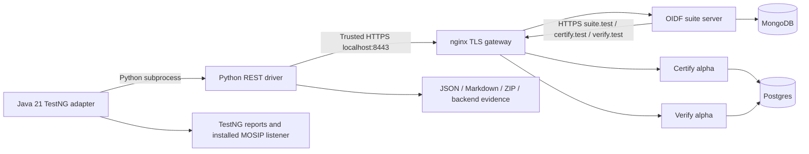

# Runtime and TLS layout

All containers share the Compose network. `suite.test`, `certify.test` and
`verify.test` resolve to the gateway inside Docker. Host Python connects to
localhost ports 8443, 8446 and 8447; the generated certificate covers both
localhost and the Docker names. Host browsers need hosts entries to visit the
advertised `.test` names; the Python handoff requires no hosts-file edit.

`prepare_local.py` generates a private development CA and SAN server certificate.
The gateway presents the leaf certificate. Python trusts `ca.crt` via
`REQUESTS_CA_BUNDLE`; each Java service trusts the certificate-only JKS through
standard JVM truststore properties. A real loopback test verifies Python and
Java trust and rejection without the CA. No JVM-global hostname bypass is set.
The CA private key is never mounted into a container. The Verify signing keystore
is mounted only into Verify. Private material stays in ignored `local/`.

Internal upstream hops use HTTP on the private Docker network. Published host
ports bind to 127.0.0.1. The 8444 listener is not configured to exercise mutual
TLS; the current diagnostic plan selects DPoP, not mTLS. Do not select mTLS until
its client-certificate forwarding and trust configuration are implemented.

Certify uses the alpha's single-pod simple-cache path with the tagged nonce and
pre-auth cache names. This is not a production/multi-pod deployment. Verify uses
the alpha entities' Hibernate schema update on a fresh development schema,
avoiding the tagged compose SQL's obsolete PEX tables.
